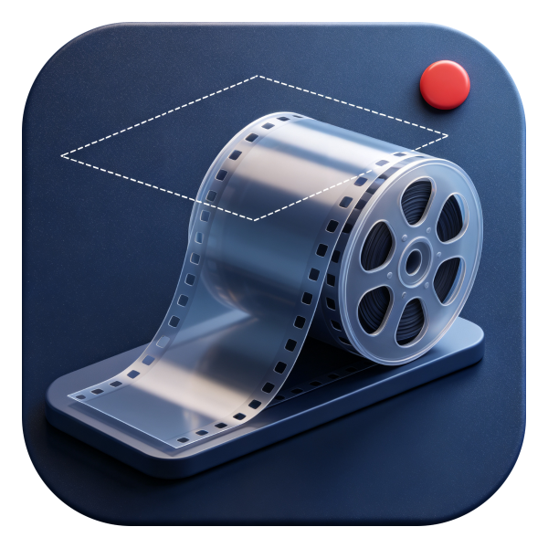
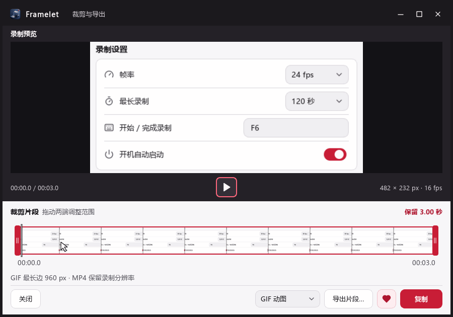
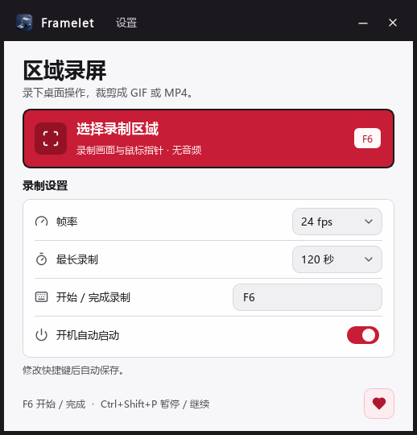

# Framelet

[简体中文](README.md) · [Quick start](#quick-start) · [Installation](#installation)



I built Framelet because I kept needing to share short screen recordings at work. When I put together a proposal, I wanted people to see what happened after they clicked a button. In a team chat, I’d type out the steps to reproduce a bug and still get asked, “Which click actually triggered it?” And when I wrote instructions, I sometimes found myself captioning several screenshots to show something a short GIF could explain.

I did this often enough that finding the recording, trimming the dead time, and converting it became a chore of its own. Framelet is a Windows region recorder that puts those steps in one place. Select an area with a shortcut, record it, then trim the ends and save a GIF or MP4. You can also copy the clip straight to the clipboard as a file.

## See it in action



*This clip shows a change in the settings window. Drag the red handles to keep the relevant seconds, then click **复制** (Copy) to generate a GIF.*

## Where it fits in a workday

| What you’re working on | What to record |
| --- | --- |
| Proposals and demos | Record a prototype’s menu, filter change, or page transition. Put the GIF next to the part of the proposal that explains the interaction. |
| Aligning on a requirement | Record what happens today and send the clip with one sentence about what should happen, such as “Keep the selected filters when I switch to this tab.” |
| Bug reports and fix verification | Record from the triggering action through the error. Add it to the ticket, then record the same area again once the fix is ready to verify. |
| How-to docs, handoffs, and onboarding | Show where a setting lives, what to change, and how to see that it took effect. Put the clip next to the step people need to follow. |
| Helping a teammate | Show how to filter a spreadsheet, find a setting in an admin tool, or export a report. Keep the clip handy for the next person who asks. |
| Weekly updates and release notes | Add a clip of a finished interaction so people who missed the demo can see how it behaves. |

## Quick start

Framelet runs on Windows 10 and 11. After launch, look for its icon in the system tray near the clock. If it’s hidden, expand the tray with the up arrow. Double-click the icon to open settings, or right-click it and choose **选择区域录制** (Select Region to Record). The app interface is in Simplified Chinese. To get it running, see [Installation](#installation).

1. **Select an area.** Press `F6`, then drag to draw a rectangle or click a highlighted window or UI area. Drag the corners to resize the selection. Use the arrow keys to nudge it.
2. **Record.** Press `Enter` or click **开始录制** (Start Recording). You can interact with the desktop during the three-second countdown. Capture begins when the countdown disappears. Press `F6` again to finish and open the editor.
3. **Trim the clip.** Drag the handles at either end of the timeline to cut the setup and the pause at the end. Click the timeline to seek, use the left and right arrow keys to step through frames, and press Space to play or pause the preview.
4. **Share or save.** GIF is selected by default. You can switch to MP4. Click **复制** (Copy) to generate the current clip. Once the button shows **已复制** (Copied), press `Ctrl+V` in File Explorer or a chat app that accepts pasted files. Click **导出片段…** (Export Clip) to choose where to save it.

<details>
<summary>View the recording settings</summary>



</details>

### Keyboard shortcuts

| Shortcut | Action |
| --- | --- |
| `F6` | Select a region when idle, finish an active recording, or cancel the countdown. You can change this shortcut in settings. |
| `Ctrl+Shift+P` | Pause or resume recording. |
| `Enter` | Confirm the selection and start the countdown. |
| `Esc` | Cancel the selection or countdown. |
| Arrow keys / `Shift` + arrow keys | Move the selection. Hold `Shift` to move it faster. |
| `←` / `→`, `Space` | Step through frames, or play or pause the preview in the editor. |

## Recording, trimming, and sharing

- **Region selection.** The desktop stays live while you select. Framelet tries to highlight windows and UI areas under the pointer, and an 8× pixel magnifier shows a grid, physical coordinates, and pixel color for lining up the edges. Each recording region fits within one monitor.
- **Screen and cursor.** Recordings include the visible system cursor and are silent. Choose 10, 16, 24, or 30 fps. The default is 24 fps. Set a recording time limit of 30, 60, or 120 seconds. The default is 120 seconds.
- **Trim the ends.** Use the timeline to set the first and last frames. The source recording stays available while you edit, so after exporting or copying a clip, you can adjust the range or generate another format.
- **Background encoding.** Export and Copy show progress and can be canceled. If encoding fails, you can retry with the original recording. Frames are stored in the system temp directory, so larger recording regions take up more temporary disk space.
- **Tray and settings.** Double-click the tray icon to change the start and finish shortcut. Changes save automatically. **开机自动启动** (Start with Windows) is on by default. You can turn it off in the same settings window.

### GIF or MP4

| Format | When to use it | Output |
| --- | --- | --- |
| GIF | A short interaction in a document, message, or issue. | Loops. The longest edge is capped at 960 px. Smaller captures keep their original size. |
| MP4 | A longer demo or a recording with small text, such as a spreadsheet or code editor. | Keeps the capture resolution, with padding if the width or height is odd. |

To show a GIF inline in a document, export it and use the editor’s image insertion feature. Files generated by Copy are stored in the `Framelet-clipboard` folder under the system temp directory. You can paste them after closing Framelet. To keep a clip long term, export it or paste it into a folder where you keep your files.

## Installation

### Use the Windows package

If you have `Framelet-3.3-Windows-x64.zip`, extract the full archive and run `Framelet\Framelet.exe`. Keep the `_internal` folder next to the executable. The package includes the runtime.

### Run from source

Install Python 3.12 on Windows, then open PowerShell in the project folder.

```powershell
py -3.12 -m pip install -r requirements.txt
py -3.12 main.py
```

If `python` already points to the interpreter with the project dependencies installed, you can also double-click `Framelet.bat`.

## Development and packaging

Framelet uses Python and PySide6 for the interface, MSS for screen capture, and FFmpeg for GIF and MP4 encoding. It maps the selection from Qt’s logical coordinates to physical pixels on the selected monitor.

```powershell
py -3.12 -m unittest discover -s tests -v
```

The unit tests run offscreen. To check Windows display scaling, live capture, and export, run `py -3.12 tests/native_smoke.py` manually. It briefly opens and records its own test canvas. The documented hardware check covers a single monitor at 125% scaling. Mixed-DPI multi-monitor setups have coordinate unit test coverage.

Use 64-bit Python 3.12 on 64-bit Windows to build the x64 package.

```powershell
py -3.12 -m pip install -r requirements.txt -r requirements-build.txt
.\build-release.bat
```

The script writes the release ZIP and its `.sha256` checksum to `dist\`. See [DISTRIBUTION.md](DISTRIBUTION.md) for the repository file list, GitHub Release assets, and packaging details (in Chinese).
