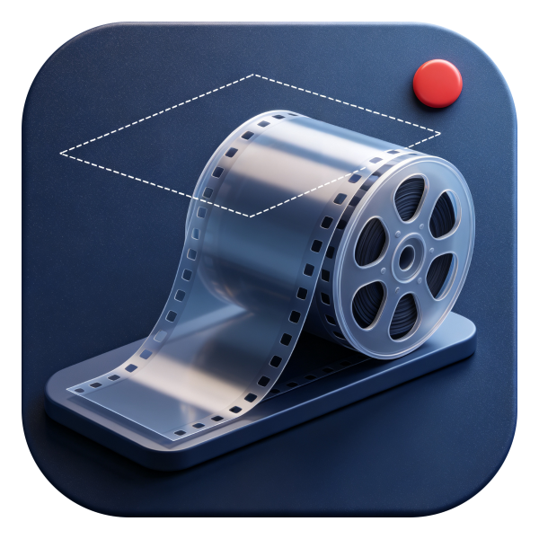
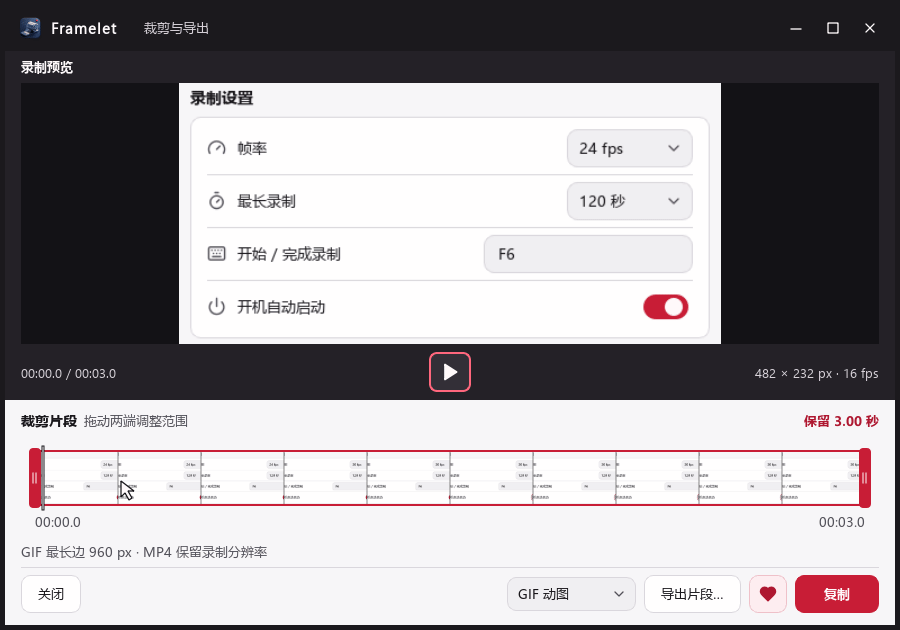
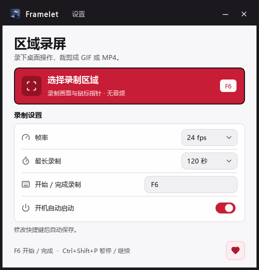

# Framelet

[English](README.en.md) · [快速开始](#快速开始) · [安装与运行](#安装与运行)



我做 Framelet，是因为以前工作里经常要发一小段录屏。做方案时，想让大家看到点下按钮以后界面怎么变。群里报问题，打了几行字，对方还是会问「你是点到哪一步才出现的？」写操作文档也是，有时得连贴几张截图，再给每张图补一句说明，几秒的 GIF 就能把顺序和结果一起讲清楚。

这种素材用得多了，录完找文件、剪首尾、转格式，就成了反复要做的事。Framelet 是一个 Windows 区域录屏工具，按快捷键框出要录的画面，录完裁掉首尾，就可以导出 GIF 或 MP4，也可以直接把文件复制到剪贴板发给同事。

## 操作演示



*按 `F6` 开始框选，用鼠标拖出录制范围，再按 `Enter` 倒计时。操作完成后再按 `F6`，就会打开「裁剪与导出」。拖动时间轴手柄裁掉首尾，点「复制」生成 GIF。*

## 哪些时候用得上

| 工作场景 | 可以录什么 |
| --- | --- |
| 写方案、做演示 | 把原型里的菜单展开、筛选切换或页面跳转录成 GIF，放在方案对应的段落，让读者看到操作前后。 |
| 在群里对齐需求 | 圈住有疑问的部分，录一遍现在的行为，配一句「切换到这里后，希望保留上次选中的筛选项」。 |
| 提 Bug、验收修复 | 从触发操作录到问题出现，附在工单里。修复后在同一区域录一遍，方便核对结果。 |
| 写操作文档、交接和带新人 | 演示从哪打开设置、在哪改参数、怎样确认生效。把片段放在对应步骤旁，读者可以跟着做。 |
| 做内部支持、回复同事 | 录下在表格里筛选记录、在后台找到入口或导出报表的路径。有同样问题时，可以把这段发给下一位同事。 |
| 发周报或功能更新 | 录一段本周刚做完的交互，放在对应更新项下，让没参加演示的人也能看到实际效果。 |

## 快速开始

Framelet 适用于 Windows 10 / 11。启动后可以在任务栏右侧的系统托盘找到它。如果图标被折叠，点任务栏的上箭头。双击图标打开设置，或右键点击「选择区域录制」。第一次使用可以先看[安装与运行](#安装与运行)。

1. **选区域。** 按 `F6`，拖动框选，或单击 Framelet 自动高亮的窗口或界面区域。拖动边角调整大小，方向键可以微调位置。
2. **录一遍。** 按 `Enter` 或点击「开始录制」。3 秒倒计时期间可以操作桌面，数字消失后开始采集。录完再按 `F6`，进入裁剪窗口。
3. **留下需要的几秒。** 拖动时间轴两端，去掉开头准备和结尾停顿。点击时间轴定位画面，按左右方向键逐帧查看，按空格播放或暂停预览。
4. **发出去或存下来。** 默认是 GIF，可以切换成 MP4。点「复制」，等按钮显示「已复制」，再用 `Ctrl+V` 粘贴到资源管理器或支持文件粘贴的聊天窗口。点「导出片段…」可以自己选保存位置。

<details>
<summary>查看录制设置界面</summary>



</details>

### 快捷键

| 快捷键 | 操作 |
| --- | --- |
| `F6` | 空闲时进入框选，录制时完成录制，倒计时期间取消。可在设置里更改。 |
| `Ctrl+Shift+P` | 暂停或继续录制。 |
| `Enter` | 确认选区并开始倒计时。 |
| `Esc` | 取消框选或倒计时。 |
| 方向键 / `Shift` + 方向键 | 移动选区，按住 `Shift` 可以加快移动。 |
| `←` / `→`，`Space` | 在裁剪窗口逐帧查看，播放或暂停预览。 |

## 录制、裁剪与分享

- **区域选择。** 桌面在框选时保持实时显示。鼠标下方的窗口或界面区域会尝试自动识别，像素放大镜提供 8 倍网格、物理坐标和颜色，便于对齐边缘。每段录制的选区位于一块显示器内。
- **画面和鼠标指针。** 录下选区画面和可见的系统鼠标指针，成片没有音轨。可选 10、16、24 或 30 fps，默认 24 fps。录制时长上限可设为 30、60 或 120 秒，默认 120 秒。
- **裁剪首尾。** 通过时间轴选定起止帧，原始录制在裁剪期间保留。导出或复制后可以继续调整片段，也可以切换格式再生成一份。
- **后台生成。** 导出和复制文件时会显示进度，可以取消，失败后可用原始录制重试。录制帧暂存于系统临时目录，高分辨率录制会用到更多磁盘空间。
- **托盘和设置。** 双击托盘图标，可以更改「开始 / 完成录制」的快捷键。改动会自动保存。「开机自动启动」默认开启，可以在同一个窗口关闭。

### GIF 还是 MP4

| 格式 | 适合什么时候用 | 输出 |
| --- | --- | --- |
| GIF | 几秒就能说清的交互，用在文档、消息或工单里。 | 循环播放，最长边为 960 px，较小的选区保持原尺寸。 |
| MP4 | 较长的演示，或需要看清表格、代码等小字的录屏。 | 保留录制分辨率，奇数宽高补边到偶数。 |

如果文档需要把 GIF 显示在正文里，可以先导出，再用文档编辑器的插入图片功能。点「复制」生成的文件暂存在系统临时目录下的 `Framelet-clipboard`，关闭 Framelet 后仍可粘贴。需要长期留档时，导出一份，或粘贴到要保存的文件夹。

## 安装与运行

### 使用 Windows 发布包

拿到 `Framelet-3.3-Windows-x64.zip` 后，完整解压，再运行其中的 `Framelet\Framelet.exe`。发布包自带运行环境，解压后请将 `_internal` 文件夹和 EXE 一起保留。

### 从源码运行

在 Windows 上安装 Python 3.12，然后在项目目录打开 PowerShell。

```powershell
py -3.12 -m pip install -r requirements.txt
py -3.12 main.py
```

如果 `python` 已指向装好依赖的解释器，也可以双击 `Framelet.bat` 启动。

## 开发与打包

Framelet 使用 Python 和 PySide6 构建界面，MSS 采集屏幕，FFmpeg 编码 GIF 和 MP4。选区会从 Qt 的逻辑坐标转换到对应显示器的物理像素。

```powershell
py -3.12 -m unittest discover -s tests -v
```

单元测试以离屏模式运行。需要检查 Windows 下的缩放、实际采集和导出时，可手动运行 `py -3.12 tests/native_smoke.py`。它会短暂打开并采集自建测试画布。现有验证记录覆盖单屏 125% 缩放。混合 DPI 多屏目前覆盖坐标单元测试。

在 64 位 Windows 上使用 64 位 Python 3.12，可以构建 x64 发布包。

```powershell
py -3.12 -m pip install -r requirements.txt -r requirements-build.txt
.\build-release.bat
```

脚本在 `dist\` 下生成发布 ZIP 和对应的 `.sha256` 文件。GitHub 仓库文件清单、Release 附件和打包细节见 [DISTRIBUTION.md](DISTRIBUTION.md)。
